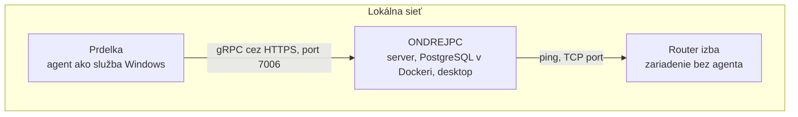

# Modelová sieť a testovacie scenáre

Bod 6 zadania vyžaduje otestovať systém v modelovej sieťovej infraštruktúre. Tento dokument opisuje topológiu, scenáre a ich očakávané výsledky. Stĺpec **Pozorovaný výsledok** sa vypĺňa až pri skutočnom spustení; prázdne pole znamená, že scenár ešte nebežal.

## Topológia

Modelovú sieť zatiaľ tvoria reálne zariadenia v jednej lokálnej sieti. Možnosť s virtuálnymi strojmi je opísaná na konci dokumentu.

| Zariadenie | Úloha | Adresa pri teste |
|---|---|---|
| ONDREJPC | server (profil `network`), databáza, desktop | doplniť pri teste |
| Prdelka | sledovaný počítač; agent nainštalovaný cez `Install-Agent.ps1` | doplniť pri teste |
| Router izba | zariadenie, ktoré nespustí agenta; kontroluje ho len server | doplniť pri teste |

Obmedzenia oproti návrhu s virtuálnymi strojmi:

- Chýba Windows Server, takže zariadenie s viacerými službami zastupuje Prdelka.
- Router spája aj oba počítače. Keď sa vypne, Prdelka stratí spojenie so serverom tiež. Na scenár D3 je preto lepšie iné zariadenie bez agenta v tej istej sieti, napríklad telefón alebo tlačiareň, ak je k dispozícii.
- Prdelka je bežný používaný počítač: scenáre s reštartom a vypnutím treba spúšťať, keď na ňom nič nebeží.

## Nastavenie pred scenármi

1. Na ONDREJPC spustiť Docker Desktop, `docker compose up -d` a server s profilom `network`.
2. Na Prdelku nainštalovať agenta z aktuálneho balíka (`Publish-Agent.ps1`).
3. V desktope nastaviť interval synchronizácie na 30 s a toleranciu na 3 vynechané intervaly: zariadenie je offline po 90 s bez kontaktu.
4. Vytvoriť používateľa `operator` s rolou, ktorá má na Prdelke len `ViewDevices` a `Ping`.

Ak má server nastavený spoločný token, prijme ním registráciu aj bez kódu. Na scenár B5 ho treba dočasne odstrániť: `dotnet user-secrets remove "Agents:EnrollmentToken" --project src/NetworkMonitoringSystem.Server`.

## Scenáre

Každý scenár sa začína so všetkými zariadeniami online.

### Dostupnosť a výpadky

| # | Scenár | Postup | Očakávaný výsledok | Pozorovaný výsledok |
|---|---|---|---|---|
| D1 | Vypnutie zariadenia | Vypnúť Prdelku | Najviac do 90 s + 10 s kontroly je offline; oranžový pruh v desktope; výpadok začína posledným kontaktom; udalosť `DeviceWentOffline`. Po zapnutí agent naskočí sám ako služba, výpadok sa ukončí | |
| D2 | Odpojenie od siete | Odpojiť sieť na Prdelke | Rovnako ako D1. Agent sa po pripojení vráti bez novej registrácie | |
| D3 | Zariadenie bez agenta | Vypnúť zariadenie bez agenta | Offline po prekročení prahu; graf odozvy sa preruší. Po zapnutí online, výpadok ukončený. Pri vypnutí routera je offline aj Prdelka | |
| D4 | Ping blokovaný, port otvorený | Vyžaduje zariadenie bez agenta, ktoré neodpovedá na ping a má otvorený port. Ak také nie je, pokrýva to automatický test `DeviceThatBlocksPing_ButAcceptsItsTcpPort_IsOnline_AndSnapshotSaysHow` | Zariadenie zostáva online; záznam stavu uvádza `ReachedBy = TcpPort` | |
| D5 | Vypadnutie servera | Zastaviť server na 5 minút a znova ho spustiť | Desktop ukáže červený pruh s časom posledných údajov. Po štarte sa agent vráti a v ochrannej dobe nevznikne falošný výpadok | |

### Sledovanie

| # | Scenár | Postup | Očakávaný výsledok | Pozorovaný výsledok |
|---|---|---|---|---|
| M1 | Záťaž procesora | Na Prdelke zaťažiť všetky jadrá na 2 minúty | Ukazovateľ procesora stúpne (nad 90 % červený); proces je medzi najnáročnejšími | |
| M2 | Nový port | Na Prdelke otvoriť počúvajúci TCP port 8081 a zatvoriť ho | Udalosť `PortOpened` s názvom procesu; v histórii aktivity začiatok a koniec | |
| M3 | Opakovane otvorený port | Ten istý program otvorí port 8081 do hodiny znova | Nové obdobie v histórii aktivity, ale žiadna ďalšia udalosť | |
| M4 | Zmena intervalu | Zmeniť interval z 30 s na 60 s | Udalosť `SettingsChanged` s autorom; agent hlási v novom intervale bez reštartu | |
| M5 | Sieťová prevádzka v grafe | Na Prdelke stiahnuť väčší súbor | Graf prevádzky ukáže výkyv | |
| M6 | Zachytávanie komunikácie | Zapnúť zachytávanie na Prdelke, spustiť ping na ONDREJPC | Do dvoch intervalov záznam ICMP s adresou ONDREJPC; obsah paketov sa neukladá | |

### Vzdialená správa

| # | Scenár | Postup | Očakávaný výsledok | Pozorovaný výsledok |
|---|---|---|---|---|
| R1 | Zastavenie služby | Príkazom zastaviť službu `Spooler` na Prdelke a znova ju spustiť | Stav príkazu Úspešný; služba je zastavená a potom beží; audit s autorom | |
| R2 | Reštart zariadenia | Príkaz Reštart na Prdelke | Zariadenie sa reštartuje do 30 s; agent po štarte hlási ďalej; počítadlá po reštarte nespôsobia výkyv v grafe prevádzky | |
| R3 | Príkaz offline zariadeniu | Poslať príkaz vypnutej Prdelke | Server odmietne: zariadenie nie je online | |
| R4 | Poslanie súboru | Poslať súbor na Prdelku | Súbor je v `C:\ProgramData\NetworkMonitoringSystem\Inbox`, odtlačok sedí; súbor sa nespustí; obsah sa na serveri zmaže | |

### Prístup a bezpečnosť

| # | Scenár | Postup | Očakávaný výsledok | Pozorovaný výsledok |
|---|---|---|---|---|
| B1 | Neoprávnený príkaz | Prihlásiť `operator` | Na Prdelke ponúka len Ping; ONDREJPC v zozname nevidí. Odmietnutie priameho volania API pokrývajú automatické testy v `AccessControlTests` | |
| B2 | Registrácia kódom | Vytvoriť kód pre zariadenie Prdelka, odinštalovať agenta s `-RemoveIdentity`, zariadenie nechať offline a nainštalovať agenta s kódom | Registrácia prejde; kód je Použitý s menom počítača; zariadenie zostane to isté | |
| B3 | Použitý, vypršaný, zrušený kód | Skúsiť registráciu každým z nich | Server odmietne; služba sa nevytvorí | |
| B4 | Falošný server | Inštalovať agenta so zlým pinom certifikátu | Agent spojenie odmietne | |
| B5 | Známe zariadenie bez správneho kódu | Bez spoločného tokenu registrovať Prdelku kódom pre nový počítač | Server odmietne | |

### Firewall

| # | Scenár | Postup | Očakávaný výsledok | Pozorovaný výsledok |
|---|---|---|---|---|
| F1 | Použitie pravidla | Na Prdelke pridať: blokovať, odchádzajúce, TCP, port 80. Overiť `Test-NetConnection example.com -Port 80` | Stav Použité; pravidlo vidno vo Windows Firewall v skupine `NetworkMonitoringSystem`; pripojenie neprejde | |
| F2 | Obnova pravidla | Pravidlo na Prdelke ručne zmazať | Agent ho pri ďalšom hlásení obnoví | |
| F3 | Odstránenie pravidla | Odstrániť pravidlo v desktope | Pri ďalšom hlásení zmizne z počítača; pripojenie znova prejde | |
| F4 | Pravidlo odrezávajúce agenta | Blokovať odchádzajúce TCP bez obmedzenia | Stav Chyba s dôvodom; agent pravidlo nepoužije a hlási ďalej | |
| F5 | Blokovanie prekladu mien | Blokovať odchádzajúce UDP bez obmedzenia, keď sa agent pripája cez meno | Stav Chyba s dôvodom; agent pravidlo nepoužije | |
| F6 | Vypnutý firewall | Na Prdelke vypnúť firewall a potom ho znova zapnúť | Záložka ukáže upozornenie, po zapnutí zmizne | |
| F7 | Odinštalovanie agenta | Nechať na Prdelke jedno pravidlo, spustiť `Uninstall-Agent.ps1` | Služba, súbory aj pravidlá sú preč; identita zostane. Spustiť ako posledný scenár | |

## Vyhodnotenie

Po spustení scenárov sa tu doplní dátum, verzia (commit) a zhrnutie: ktoré scenáre prešli, ktoré odhalili chybu a ako bola opravená.

## Neskoršia možnosť: virtuálne stroje

Pôvodný návrh sú štyri virtuálne stroje v Hyper-V na jednom počítači s interným prepínačom: server, Windows 11 s agentom, Windows Server s agentom a malý Linux bez agenta. Dá sa v ňom bezpečne vypínať a odpájať čokoľvek a chýbajúci Windows Server by pribudol. Vyžaduje zapnúť Hyper-V a dostatok pamäte.
